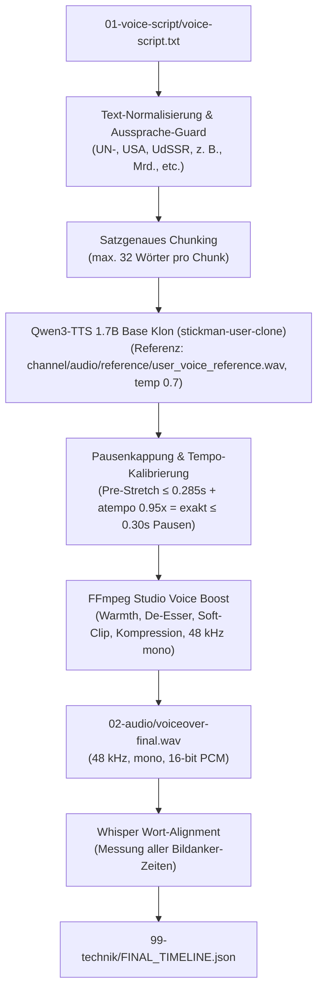

# Automatisierte Open-Source-Voiceover-Pipeline für Weltlogik

Dieses Dokument beschreibt die vollautomatische, kostenlose und lokal integrierte Voiceover-Pipeline für den YouTube-Kanal **Weltlogik** (Geopolitik, historische Konflikte & politische Bildung).

---

## 1. Übersicht & Zielsetzung

- **Problem:** Manuelle Sprachaufnahmen sind zeitaufwendig; kommerzielle Cloud-TTS-Dienste verbrauchen teure Monats-Credits und haben starre API-Limits.
- **Lösung:** Vollautomatische State-of-the-Art Text-to-Speech-Generierung direkt auf dem Mac via **Qwen3-TTS 1.7B Base** (`mlx-community/Qwen3-TTS-12Hz-1.7B-Base-bf16` auf Apple Silicon Metal GPU / `mlx-audio`).
- **Kanalstimme (`stickman-user-clone`):** Exakter 1:1 Stimmklon aus deiner eigenen Referenzaufnahme (`channel/audio/reference/user_voice_reference.wav`, 18,475 s, 24 kHz mono PCM). Alle alten Test- und Drittstimmen wurden restlos entfernt.
- **Kalibrierte Parameter:**
  - **Tempo:** **0.95x** (`rate: "-5%"`, via FFmpeg `atempo=0.95`) für ruhige, natürliche und souveräne Erklär-Autorität.
  - **Maximale Pausen:** **0.30 s** nach Tempo-Anpassung (`0.285 s` vor `atempo=0.95`, mit weichen Cosinus-Fades) für flüssigen Erzählfluss ohne unnatürliche Löcher.
  - **Chunk-Größe:** **max. 32 Wörter pro Chunk** bei `temperature: 0.7`.
- **Kosten:** **0 € / 0 Credits**, 100% offline-fähig, unbegrenzt nutzbar für Shorts und 20-Minuten-Dokus.
- **Qualität:** Studio Broadcast-Standard (`voiceBoost`: Highpass 75 Hz, De-Esser, Warmth +2.8 dB @ 180 Hz, Presence +1.8 dB @ 3.2 kHz, AI-Sheen-Taming -1.8 dB @ 11.5 kHz, Tanh-Softclip, subtiler Raumklang, Broadcast-Kompression & Limiter auf 48 kHz mono 16-bit PCM).

---

## 2. Architektur



---

## 3. Verbindliches Stimm-Preset

| Preset | Engine / Modell | Tempo | Max. Pause | Chunk-Limit | Referenz-Audio |
| :--- | :--- | :--- | :--- | :--- | :--- |
| **`stickman-user-clone`** *(EINZIGER STANDARD)* | `qwen-mlx` (`Qwen3-TTS-12Hz-1.7B-Base-bf16`) | **0.95x** (`-5%`) | **≤ 0.30s** (`0.285s` pre-stretch) | **32 Wörter** | `channel/audio/reference/user_voice_reference.wav` |

Die Konfiguration ist zentral in `config/voice-policy.json` hinterlegt.

---

## 4. Text-Normalisierung & Aussprache-Guard

Der Voice-Generator bereinigt das Skript vor der Synthese automatisch gegen typische TTS-Aussprachefallen im deutschen Politik- und Geschichtsdiskurs:

1. **Regieanweisungen & Markdown:**
   - Entfernt `[Szene ...]`, `[Musik ...]`, `(Pause)`, `(flüstert)` und Überschriften (`#`).
2. **Geopolitische Akronyme:**
   - `UN-Sicherheitsrat` / `UN-Veto` → `U-N-Sicherheitsrat` / `U-N-Veto` *(verhindert das Verschleifen zu „un-“)*.
   - `UN` → `U-N`
   - `USA` → `U-S-A`
   - `UdSSR` → `U-d-S-S-R`
   - `EU` → `E-U`
   - `BVerfG` → `Bundesverfassungsgericht`
   - `BIP` → `B-I-P`
   - `LNG` → `L-N-G`
3. **Zahlen & Abkürzungen:**
   - `z. B.` → `zum Beispiel`
   - `d. h.` → `das heißt`
   - `bzw.` → `beziehungsweise`
   - `ca.` → `circa`
   - `Mrd.` → `Milliarden`
   - `Mio.` → `Millionen`
   - `km²` → `Quadratkilometer`
   - `§ 12` → `Paragraph 12`
   - `Art. 108` → `Artikel 108`
   - `50%` → `50 Prozent`

---

## 5. CLI-Befehle & Workflows

### Standard-Generierung mit der kalibrierten Master-Stimme:
```bash
npm run voice:youtube -- --dir "youtube/2026-KW43_19-10_bis_25-10/un-veto-wie-ein-land-einen-beschluss-stoppen-kann" --force
```

### Vorschau & Skriptanalyse ohne Audiogenerierung (Dry-Run):
```bash
npm run voice:youtube -- --dir "youtube/..." --dry-run
```

### Direktes Voiceover + automatisches Whisper-Alignment:
```bash
npm run voice:youtube -- --dir "youtube/..." --force --align
```

### Aktives Preset im Terminal prüfen:
```bash
npm run voice:youtube -- --list-presets
```

---

## 6. Lokale Voraussetzungen & Caching

Die Engine nutzt die lokale Python-Umgebung unter `/Users/arman/finanzneo-tts/.venv` (`sprecher.py`) und das gecachte Qwen3-Base-Modell unter `/Users/arman/finanzneo-tts/hf`.
- **Master-Referenz im Repo:** `channel/audio/reference/user_voice_reference.wav` (mit Metadaten in `user_voice_reference.json`).
- **Speicherverwaltung:** `mlx.core.set_cache_limit` und sequenzielle 32-Wort-Chunks verhindern OOM-Fehler auf Apple Silicon Macs.
