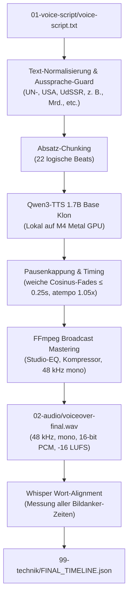

# Automatisierte Open-Source-Voiceover-Pipeline für Weltlogik

Dieses Dokument beschreibt die vollautomatische, kostenlose und lokal integrierte Voiceover-Pipeline für den YouTube-Kanal **Weltlogik** (Geopolitik, historische Konflikte & politische Bildung).

---

## 1. Übersicht & Zielsetzung

- **Problem:** Manuelle Sprachaufnahmen sind zeitaufwendig; kommerzielle Cloud-TTS-Dienste verbrauchen teure Monats-Credits und haben starre API-Limits.
- **Lösung:** Vollautomatische State-of-the-Art Text-to-Speech-Generierung direkt auf dem Mac via **Qwen3-TTS 1.7B Base** (Apple Silicon Metal GPU / `mlx-audio`).
- **Kanalstimme:** 1:1 Klon der bewährten Google-KI-Stimme aus Armans bisherigen Videos (Referenz aus dem Kanalarchiv).
- **Pacing:** Variante 3: **1.05x Tempo** mit automatischer Pausenkappung auf **maximal 0,25 s** für lebendigen, vorwärtsdrängenden Erzählfluss ohne störende Leerläufe.
- **Kosten:** **0 € / 0 Credits**, 100% offline-fähig, unbegrenzt nutzbar für Shorts und 20-Minuten-Dokus.
- **Qualität:** Studio Broadcast-Standard (48 kHz, -16 LUFS Loudness, Studio-EQ & Kompression).

---

## 2. Architektur



---

## 3. Stimm-Presets für Weltlogik

| Preset | Typ / Engine | Tempo | Pausen | Charakter / Verwendung |
| :--- | :--- | :--- | :--- | :--- |
| **`weltlogik-alte-stimme-klon`** *(STANDARD)* | Qwen3-TTS 1.7B Base Klon | **1.05x** | **≤ 0.25s** | **1:1 Nachbau der bewährten Kanalstimme** aus bisherigen Videos. Vertraut, menschlich, lebendig, perfekte Balance für Shorts & Langform. |
| **`weltlogik-explainer-storyteller`** | Qwen3-TTS VoiceDesign | 1.00x | ≤ 0.22s | **Moderner Video-Essayist** (Simplicissimus / MrWissen2go Vibe). Neugierig, dynamisch. |
| **`weltlogik-nathan`** | Qwen3-TTS VoiceDesign | 1.00x | ≤ 0.22s | **David Nathan Klon** (Christian Bale / Stephen King Thriller). Dunkler Vocal-Fry, packend. |
| **`weltlogik-brueckner`** | Qwen3-TTS VoiceDesign | 1.00x | ≤ 0.25s | **Christian Brückner Klon** (Die 'Stimme der Nation'). Rauchiger Doku-Bariton. |
| **`weltlogik-florian-studio`** | edge-tts (Fallback) | +4% | 0.35s | Schneller Fallback ohne GPU-Bedarf. |
| **`weltlogik-signature`** | edge-tts (Fallback) | +4% | 0.35s | Killian Bariton Fallback. |

---

## 4. Text-Normalisierung & Aussprache-Guard

Der Voice-Generator bereinigt das Skript vor der Synthese automatisch gegen typische TTS-Aussprachefallen im deutschen Politik- und Geschichtsdiskurs:

1. **Regieanweisungen & Markdown:**
   - Entfernt `[Szene ...]`, `[Musik ...]`, `(Pause)`, `(flüstert)` und Überschriften (`#`).
2. **Geopolitische Akronyme:**
   - `UN-Sicherheitsrat` / `UN-Veto` → `U-N-Sicherheitsrat` / `U-N-Veto` *(verhindert das Verschleifen zu „un-“)*.
   - `UN` → `U-N`
   - `USA` → `U-S-A`
   - `UdSSR` → `U-d-S-S-R`
   - `EU` → `E-U`
   - `BVerfG` → `Bundesverfassungsgericht`
   - `BIP` → `B-I-P`
   - `LNG` → `L-N-G`
3. **Zahlen & Abkürzungen:**
   - `z. B.` → `zum Beispiel`
   - `d. h.` → `das heißt`
   - `bzw.` → `beziehungsweise`
   - `ca.` → `circa`
   - `Mrd.` → `Milliarden`
   - `Mio.` → `Millionen`
   - `km²` → `Quadratkilometer`
   - `§ 12` → `Paragraph 12`
   - `Art. 108` → `Artikel 108`
   - `50%` → `50 Prozent`

---

## 5. CLI-Befehle & Workflows

### Standard-Generierung mit der Kanalstimme:
```bash
npm run voice:youtube -- --dir "youtube/2026-KW43_19-10_bis_25-10/un-veto-wie-ein-land-einen-beschluss-stoppen-kann" --force
```

### Vorschau & Skriptanalyse ohne Audiogenerierung (Dry-Run):
```bash
npm run voice:youtube -- --dir "youtube/..." --dry-run
```

### Direktes Voiceover + automatisches Whisper-Alignment:
```bash
npm run voice:youtube -- --dir "youtube/..." --force --align
```

### Alternatives Preset wählen:
```bash
npm run voice:youtube -- --dir "youtube/..." --preset weltlogik-explainer-storyteller --force
```

### Presets im Terminal auflisten:
```bash
npm run voice:youtube -- --list-presets
```

---

## 6. Lokale Voraussetzungen & Caching

Die Engine nutzt die lokale Python-Umgebung unter `~/finanzneo-tts/.venv` und das gecachte Qwen3-Base-Modell unter `~/finanzneo-tts/hf`. 
- **Kein Neu-Download** erforderlich: Modell (4,5 GB) ist dauerhaft auf der SSD gesichert.
- **Speicherverwaltung:** `mlx.core.set_cache_limit` und sequenzielle Chunks verhindern OOM-Fehler auf 16 GB M-Series Macs.
